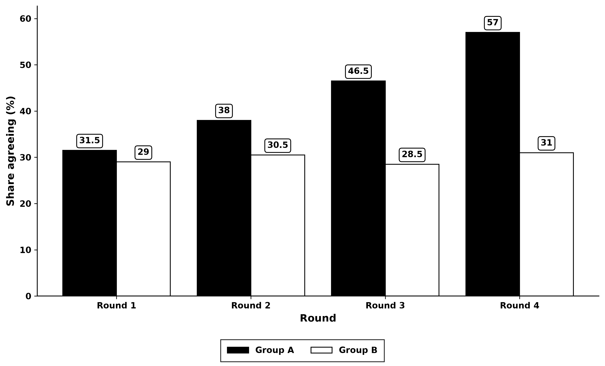
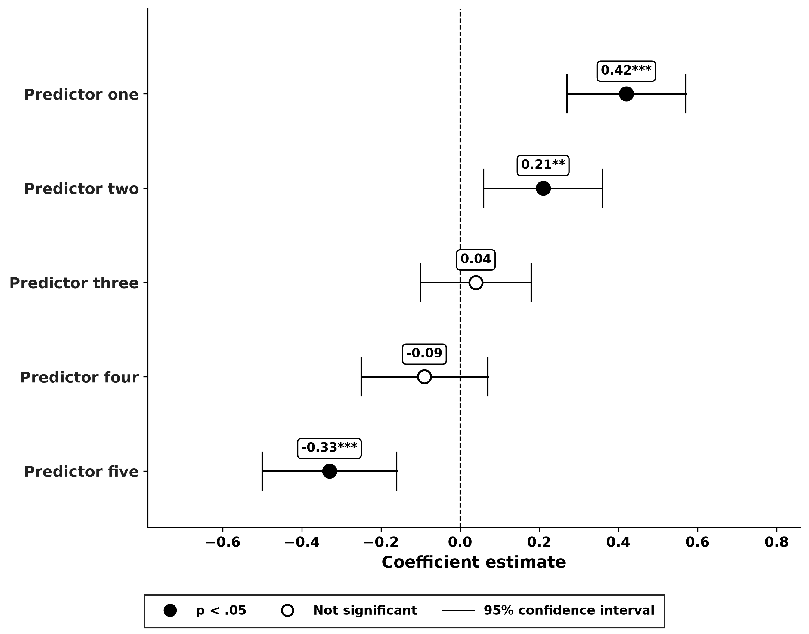
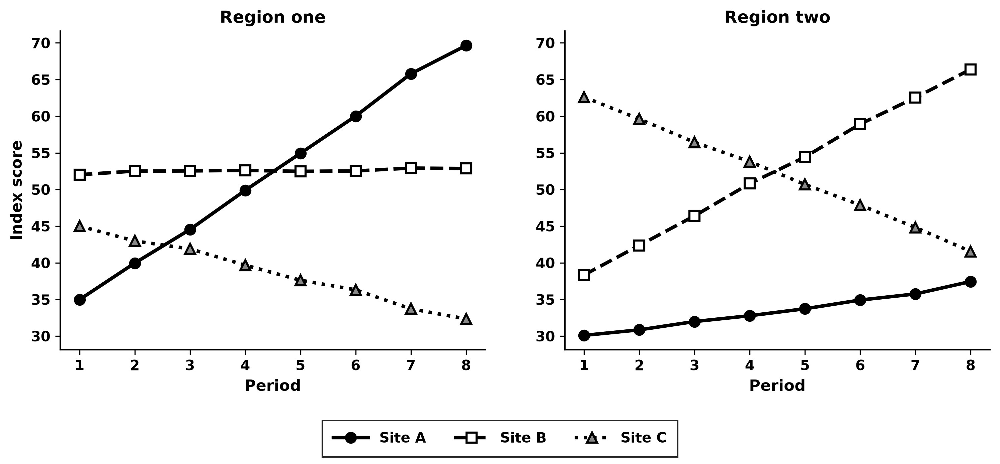
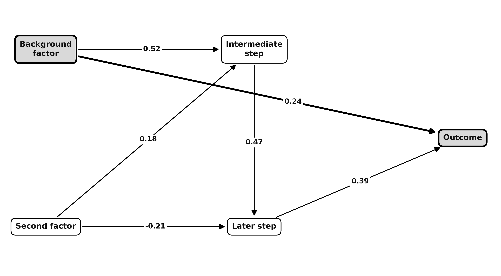

# whatsthepoint

<!-- tagline: Alex writes this -->

A Python package for survey data in the social sciences: loading and harmonizing survey files, common analyses (regression, panel, causal, SEM, text) and figures in one house style.

## Install

```bash
pip install git+https://github.com/AlexanderTheAlright/whatsthepoint.git
```

## Usage

```python
import pandas as pd
from whatsthepoint.visuals.bar import bar
from whatsthepoint.utils.style import save_figure

shares = pd.DataFrame({"Round": ["Round 1", "Round 2", "Round 3"],
                       "Group A": [31.5, 38.0, 46.5], "Group B": [29.0, 30.5, 28.5]})
fig, ax = bar(shares, x="Round", y="Share agreeing (%)", orientation="grouped")
save_figure(fig, "bar_grouped")  # writes bar_grouped.png and bar_grouped.svg
```

## Styles

Every plotting function takes `style_mode`.

- `house`: black, white and greys, one boxed legend below the panels, checked for overlap; the default
- `viridis`: viridis colours
- `reviewer3`: black, white and greys, earlier layout
- `sentiment`: green for positive, red for negative
- `fiery`: reds, oranges and purples
- `plainjane`: light red and blue

## Figures






All nine samples are in `docs/samples/`, drawn by `docs/sim_make_samples.py` on simulated data.

## Tests

```bash
pip install pytest && pytest -q
```

## Licence

MIT. See `LICENSE`.
